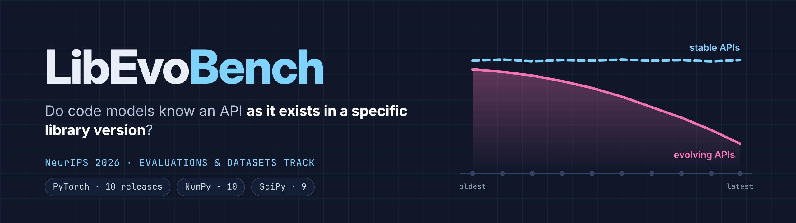
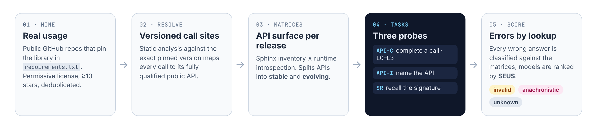
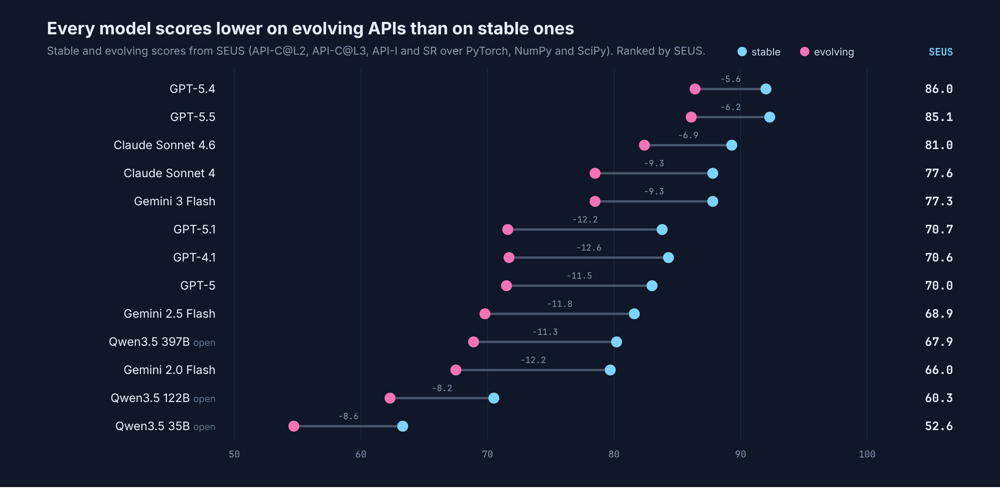
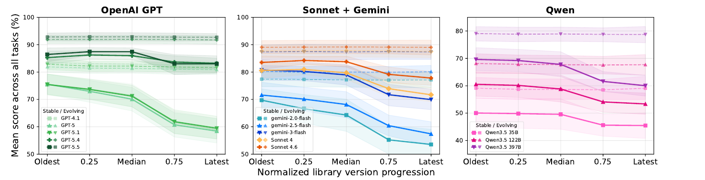
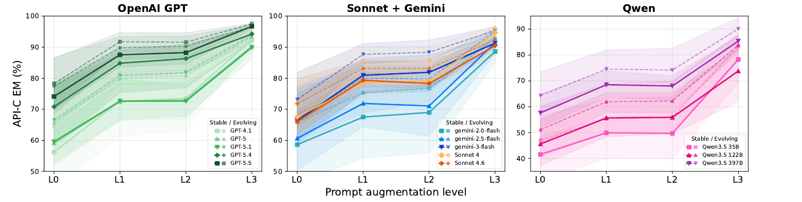

<div align="center">



Daniele Cipollone<sup>1,2</sup> · Sergey Titov<sup>2</sup> · Maliheh Izadi<sup>1</sup> · Egor Bogomolov<sup>2</sup> · Arie van Deursen<sup>1</sup><br>
<sup>1</sup>Delft University of Technology · <sup>2</sup>JetBrains Research

<p>
<a href="https://jetbrains-research.github.io/LibEvoBench/"></a>
<a href="https://neurips.cc/virtual/2026/poster/139459"></a>
<a href="https://arxiv.org/abs/2606.25402"></a>
<a href="https://huggingface.co/datasets/JetBrains/LibEvoBench"></a>
<a href="https://doi.org/10.5281/zenodo.20066456"></a>
</p>
<p>


</p>

</div>

---

Code models are trained on code written against many versions of a library at once. **LibEvoBench** asks whether a model knows an API *as it exists in a specific library version*. It covers **29 releases** of PyTorch, NumPy and SciPy and **13 models** from four families, with three tasks:

| Task | Code name | What the model does |
|---|---|---|
| **API Calling** (API-C) | `t1` | Completes a real call site, at prompt levels L0 (code only) to L3 (code, docstring, version pin and parameter hint) |
| **API Identification** (API-I) | `t2` | Names the API from a redacted description |
| **Signature Recall** (SR) | `t3` | Writes the full signature of an API at a given version |

<p align="center"></p>

## TL;DR

- **Even SOTA models lag on version-specific knowledge**: a persistent 5–10 point gap between stable and evolving APIs that neither scale nor training recency closes.
- **Models don't store the version as a dimension of library knowledge**: giving the target version yields no gain, while giving documentation adds +10–20 points.
- **Failures are temporal confusion, not fabrication:** models fall back on version-agnostic, high-frequency symbols that hide the gap.

<p align="center"></p>

<details>
<summary><b>Version-decay and prompt-level curves</b></summary>
<br>


</details>

The full interactive leaderboard, per library and task, is on the [project page](https://jetbrains-research.github.io/LibEvoBench/#leaderboard).

This repository has the evaluation pipeline, the prompts, and the raw and scored outputs of all 13 models. Every number and figure in the paper can be recomputed from `out/` without calling any model.

## Repository layout

```
src/eval_benchmark/
  run_eval.py     compose prompts and query a model (step 1)
  score.py        score completions against the compatibility matrices (step 2)
  analysis.py     error taxonomy and per-model JSON report (step 3)
  seus.py         Software Evolution Understanding Score (step 4)
prompts/          prompt templates for t1 (L0-L3), t2 and t3, with few-shot examples
scripts/
  download_data.py           fetch the benchmark from Hugging Face into out/benchmark_db/
  plot_model_families.py     version-progression and prompt-level figures
  plot_taxonomy_stacks.py    error-taxonomy figures
out/
  benchmark_db/{lib}/        benchmark tables, downloaded from Hugging Face (not tracked in git)
  eval_benchmark/{lib}/      raw and scored model outputs for the 13 models
docs/                        project page (GitHub Pages)
```

`{lib}` is `torch`, `numpy` or `scipy`.

## Setup

Requires Python 3.12+ and [uv](https://docs.astral.sh/uv/).

```bash
git clone https://github.com/JetBrains-Research/LibEvoBench.git
cd LibEvoBench
uv sync
uv run scripts/download_data.py   # fetch the benchmark tables into out/benchmark_db/
```

## The data

`out/benchmark_db/{lib}/` holds six tables per library:

| File | Contents |
|---|---|
| `benchmark_t1.parquet` | API Calling instances |
| `benchmark_t2.parquet` | API Identification instances |
| `benchmark_t3.parquet` | Signature Recall instances |
| `api_comp_matrix.parquet` | which APIs exist in which release |
| `sign_comp_matrix.parquet` | the signature of each API in each release |
| `api_dictionary.parquet` | the tracked APIs and their documentation |

The same tables are on [Hugging Face](https://huggingface.co/datasets/JetBrains/LibEvoBench), one configuration per library and table (`torch__benchmark_t1`, `numpy__api_comp_matrix`, ...):

```python
from datasets import load_dataset

ds = load_dataset("JetBrains/LibEvoBench", "torch__benchmark_t1", split="train")
```

`out/benchmark_db/` is not stored in the repository, because the same tables are on Hugging Face. Rebuild it with `download_data.py` (files that already exist are skipped):

```bash
uv run scripts/download_data.py                  # all three libraries
uv run scripts/download_data.py --libs torch     # one library
```

## Reproduce the paper's figures and scores

These steps read the shipped model outputs in `out/eval_benchmark/` and the benchmark tables in `out/benchmark_db/` (downloaded during setup). They need no API key.

```bash
# SEUS leaderboard for all models and libraries (CSV next to the scored files)
uv run -m src.eval_benchmark.seus

# Version-progression curves, stable vs evolving APIs
uv run scripts/plot_model_families.py --plot normalized-versions --libs torch numpy scipy

# API Calling exact match by version, per library
uv run scripts/plot_model_families.py --plot t1-lifecycle-L1 --lib torch

# API Calling accuracy across prompt levels L0-L3, aggregated over libraries
uv run scripts/plot_model_families.py --plot t1-staircase-aggregated --libs torch numpy scipy

# Error taxonomy (API level: API-C@L2 and API-I; parameter level: API-C@L3 and SR) for one model
uv run scripts/plot_taxonomy_stacks.py --model openai/gpt-5.1 --libs torch numpy scipy
```

Figures are written to `out/figures/`. Pass `--out <path.pdf>` to a plotting script to choose another path.

## Evaluate a model

The pipeline uses the OpenAI-compatible API. Set `OPENAI_API_KEY` in your environment or in a `.env` file. To reach other providers or a local server (for example a LiteLLM proxy or vLLM), also set `OPENAI_BASE_URL`:

```bash
export OPENAI_API_KEY=...
export OPENAI_BASE_URL=https://your-proxy.example.com/   # optional
```

Run the four steps per model and library:

```bash
# 1. Prompt the model and store raw completions
uv run -m src.eval_benchmark.run_eval --lib torch --model openai/gpt-5

# 2. Score the completions
uv run -m src.eval_benchmark.score --lib torch --model openai/gpt-5

# 3. Classify errors and write a JSON report
uv run -m src.eval_benchmark.analysis --lib torch --model openai/gpt-5

# 4. Compute SEUS over every scored model
uv run -m src.eval_benchmark.seus
```

Useful options for `run_eval` (see `--help` for all):

| Option | Default | Meaning |
|---|---|---|
| `--tasks` | `t1 t2 t3` | tasks to run |
| `--levels` | `L0 L1 L2 L3` | API Calling prompt levels |
| `--num-workers` | `256` | parallel requests |
| `--seed` | `42` | sampling seed |

The paper's runs use zero temperature and no thinking budget. A full run is about 172k requests per model across the three libraries.

Outputs go to `out/eval_benchmark/{lib}/`:

| File | Written by |
|---|---|
| `eval_raw_t{1,2,3}_{model}_{lib}.parquet` | step 1 |
| `eval_scored_t{1,2,3}_{model}_{lib}.parquet` | step 2 |
| `report_{model}_{lib}.json` | step 3 |

`{model}` is the model name with `/` replaced by `_`, for example `openai_gpt-5.4`.

## Models in the paper

Scored outputs are included for these 13 models. Use the names as `--model`:

| Family | Models |
|---|---|
| OpenAI | `openai/gpt-4.1`, `openai/gpt-5`, `openai/gpt-5.1`, `openai/gpt-5.4`, `openai/gpt-5.5` |
| Anthropic | `anthropic/claude-sonnet-4-20250514`, `anthropic/claude-sonnet-4-6` |
| Google | `vertex_ai/gemini-2.0-flash`, `vertex_ai/gemini-2.5-flash`, `vertex_ai/gemini-3-flash-preview` |
| Qwen (open weights) | `external-collaborators/qwen3_5-35b-a3b`, `external-collaborators/qwen3_5-122b-a10b`, `external-collaborators/qwen3_5-397b-a17b` |

## License

- **Code** (`src/`, `scripts/`, `prompts/`, `docs/`): Apache License 2.0, see [LICENSE](LICENSE).
- **Data** (`out/` and the [Hugging Face dataset](https://huggingface.co/datasets/JetBrains/LibEvoBench)): [CC BY 4.0](https://creativecommons.org/licenses/by/4.0/). The benchmark includes code snippets mined from public GitHub repositories with permissive licenses; each snippet remains under the license of its source repository.

## Citation

```bibtex
@inproceedings{cipollone2026libevobench,
  title     = {{LibEvoBench}: Probing Temporal Knowledge Stratification
               in Code Generation Models},
  author    = {Cipollone, Daniele and Titov, Sergey and Izadi, Maliheh
               and Bogomolov, Egor and van Deursen, Arie},
  booktitle = {Advances in Neural Information Processing Systems},
  year      = {2026}
}
```
